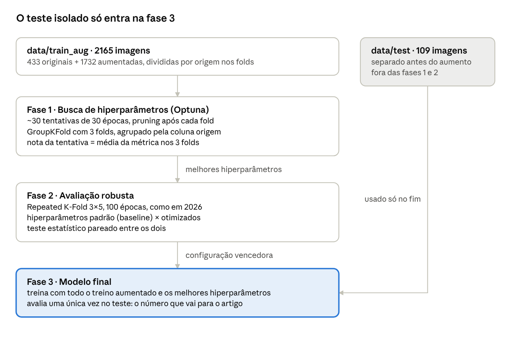

# Hiperparâmetros do YOLO e busca com Optuna

2 de novembro de 2026, atualizado em 8 de novembro de 2026 · Rodrigo Gossi

Em 2027 vamos otimizar 6 hiperparâmetros do YOLO com Optuna, escolhendo a combinação que dá o menor erro na medição da área da colônia (MAPE), e comparar o resultado com o treino de 2026, que usou os valores padrão.

## Contexto

Hiperparâmetro é uma configuração escolhida antes do treino, que o modelo não aprende sozinho: taxa de aprendizado, otimizador, intensidade das augmentations, tamanho do modelo. A escolha muda o desempenho final, e o padrão da biblioteca não é necessariamente o melhor para um dataset específico.

No treino de 2026 (YOLOv8n-seg, Repeated K-Fold 3×5), o `model.train()` recebeu só `epochs=100`, `batch=16`, `imgsz=640/1024` e `seed=42`. Todo o resto ficou no padrão da Ultralytics, ou seja, nenhum hiperparâmetro foi ajustado.

As listas, os valores padrão e os intervalos deste documento vêm do pacote oficial `ultralytics` 8.4.198: o arquivo `cfg/default.yaml` (valores padrão) e o `engine/tuner.py` (espaço de busca do tuner da própria Ultralytics).

## Inventário dos hiperparâmetros

Dos cerca de 60 argumentos do `model.train()`, 43 afetam o treino de segmentação; os demais são caminhos, salvamento, hardware ou de outras tarefas. A coluna Decisão resume o que fazemos com cada um: **Optuna** (busca principal), **Optuna 2ª fase** (se sobrar orçamento), **Fixo** (definido pelo desenho do experimento) ou **Padrão** (mantido no valor da Ultralytics).

### Otimização

| Parâmetro | Padrão | Intervalo do tuner | O que controla | Decisão |
| --- | --- | --- | --- | --- |
| `optimizer` | auto | SGD, AdamW, Adam, NAdam, RAdam, RMSProp… | algoritmo que atualiza os pesos | **Optuna** |
| `lr0` | 0,01 | 1e-5 – 1e-2 | taxa de aprendizado inicial | **Optuna** |
| `momentum` | 0,937 | 0,7 – 0,98 | inércia do SGD / beta1 do Adam | **Optuna** |
| `weight_decay` | 0,0005 | 0 – 0,001 | regularização L2 contra overfitting | **Optuna** |
| `lrf` | 0,01 | 0,01 – 1,0 | fração final do lr (lr final = lr0 × lrf) | Optuna 2ª fase |
| `warmup_epochs` | 3,0 | 0 – 5 | épocas de aquecimento com lr baixo | Optuna 2ª fase |
| `warmup_momentum` | 0,8 | 0 – 0,95 | momentum durante o aquecimento | Padrão |
| `warmup_bias_lr` | 0,1 | — | lr do bias durante o aquecimento | Padrão |
| `cos_lr` | False | — | queda do lr em cosseno em vez de linear | Padrão |
| `batch` | 16 | — | imagens por passo | Fixo (16) |
| `nbs` | 64 | — | batch nominal (acumula gradiente) | Padrão |

### Duração e parada

| Parâmetro | Padrão | Intervalo do tuner | O que controla | Decisão |
| --- | --- | --- | --- | --- |
| `epochs` | 100 | — | número de épocas | Fixo (30 na busca, 100 na avaliação) |
| `patience` | 100 | — | para cedo sem melhora na validação | Fixo |
| `close_mosaic` | 10 | 0 – 10 | desliga o mosaic nas últimas N épocas | Padrão |
| `time` | — | — | limite de horas (substitui epochs) | Padrão |

### Pesos da função de perda

| Parâmetro | Padrão | Intervalo do tuner | O que controla | Decisão |
| --- | --- | --- | --- | --- |
| `box` | 7,5 | 1 – 20 | peso do erro da caixa | Padrão |
| `cls` | 0,5 | 0,1 – 4 | peso do erro de classe | Padrão |
| `dfl` | 1,5 | 0,4 – 12 | peso do refinamento das bordas da caixa | Padrão |
| `cls_pw` | 0,0 | 0 – 1 | peso por classe para desbalanceamento | Padrão |

### Augmentation online (aplicada pelo YOLO durante o treino)

| Parâmetro | Padrão | Intervalo do tuner | O que controla | Decisão |
| --- | --- | --- | --- | --- |
| `mosaic` | 1,0 | 0 – 1 | probabilidade de juntar 4 imagens em 1 | **Optuna** |
| `hsv_s` | 0,7 | 0 – 0,9 | variação de saturação | Optuna 2ª fase |
| `hsv_v` | 0,4 | 0 – 0,9 | variação de brilho | Optuna 2ª fase |
| `degrees` | 0,0 | 0 – 45 | rotação (± graus) | Optuna 2ª fase |
| `scale` | 0,5 | 0 – 0,95 | zoom uniforme (±) | Optuna 2ª fase |
| `hsv_h` | 0,015 | 0 – 0,1 | variação de matiz (cor) | Padrão |
| `translate` | 0,1 | 0 – 0,9 | deslocamento (± fração) | Padrão |
| `fliplr` | 0,5 | 0 – 1 | espelhamento horizontal | Padrão |
| `flipud` | 0,0 | 0 – 1 | espelhamento vertical | Padrão |
| `shear` | 0,0 | 0 – 10 | cisalhamento (± graus) | Fixo (0) |
| `perspective` | 0,0 | 0 – 0,001 | distorção de perspectiva | Fixo (0) |
| `mixup` | 0,0 | 0 – 1 | sobreposição de duas imagens | Fixo (0) |
| `cutmix` | 0,0 | 0 – 1 | recorte de uma imagem colado em outra | Fixo (0) |
| `copy_paste` | 0,0 | 0 – 1 | copia objetos segmentados para outras imagens | Fixo (0) |
| `bgr` | 0,0 | 0 – 1 | troca dos canais RGB ↔ BGR | Padrão |

### Entrada, segmentação e arquitetura

| Parâmetro | Padrão | Intervalo do tuner | O que controla | Decisão |
| --- | --- | --- | --- | --- |
| tamanho do modelo | `yolov8n-seg` (2026) | — | n, s, m: capacidade × custo | **Optuna** (n ou s) |
| `imgsz` | 640 | — | resolução de entrada | Fixo (640 e 1024, experimentos separados) |
| `pretrained` | True | — | parte dos pesos do COCO | Fixo (True) |
| `freeze` | — | — | congela as primeiras N camadas | Padrão |
| `overlap_mask` | True | — | junta as máscaras das instâncias no treino | Padrão |
| `mask_ratio` | 4 | — | redução da máscara no treino | Padrão |
| `multi_scale` | 0,0 | — | varia o tamanho da entrada a cada batch | Padrão |
| `rect` | False | — | batches retangulares | Padrão |
| `single_cls` | False | — | trata todas as classes como uma | Fixo (False) |

Ficam fora porque não são hiperparâmetros de modelo: `seed`, `deterministic`, `amp`, `workers`, `cache`, `device`, `fraction`. Ficam fora porque são de outras tarefas: `pose`, `kobj`, `rle`, `angle`, `dlog`, `dgrad`, `dlam`, `dis`, `dropout`, `auto_augment`, `erasing`.

## Parâmetros fixos e por quê

Os 12 parâmetros fixos se dividem em dois grupos: os que estragariam a medição de área e os que definem o próprio experimento.

### Desligados porque distorcem a medição de área

A área é calculada pela razão `área_fungo / área_escala` dentro de cada foto. Uma augmentation que deforma a imagem de forma desigual muda essa razão, e o modelo passaria a ver uma escala de 4 × 4 cm que não é quadrada.

| Parâmetro | Valor | Motivo |
| --- | --- | --- |
| `shear` | 0 | inclina a imagem e transforma o quadrado da escala em paralelogramo |
| `perspective` | 0 | encolhe um lado da imagem mais que o outro, mudando a razão fungo/escala |
| `mixup` | 0 | sobrepõe duas placas transparentes; a foto resultante não existe no mundo real |
| `cutmix` | 0 | cola um pedaço de outra placa, podendo cortar a colônia ou a escala |
| `copy_paste` | 0 | cria colônias extras, e o pipeline de área soma todas as colônias da foto |

O mesmo critério foi usado no aumento offline (`scripts/augment.py`).

### Fixos pelo desenho do experimento

| Parâmetro | Valor | Motivo |
| --- | --- | --- |
| `epochs` | 30 na busca, 100 na avaliação | 100 épocas em cada tentativa não cabem no orçamento de GPU; a avaliação final volta a 100, como em 2026 |
| `imgsz` | 640 e 1024 | resolução é uma pergunta do estudo (como em 2026), com busca separada para cada uma |
| `batch` | 16 | igual a 2026 e limitado pela memória da T4; o `nbs=64` já normaliza o gradiente |
| `patience` | 100 | sem parada antecipada, para todas as tentativas terem a mesma duração |
| `pretrained` | True | partir dos pesos do COCO é essencial com 542 imagens |
| `single_cls` | False | escala e fungo precisam ser classes diferentes para o cálculo da área |
| `seed` | 42 | reprodutibilidade, igual a 2026 |

Os demais parâmetros ficam no padrão da Ultralytics: têm efeito menor ou já são bem calibrados para segmentação, e cada parâmetro a mais exige mais tentativas do Optuna.

## Espaço de busca do Optuna

A busca principal otimiza 6 parâmetros; outros 6 entram numa segunda fase só se sobrar orçamento. Cada parâmetro a mais exige mais tentativas para o Optuna convergir, e com cerca de 30 tentativas de \~2 h cada, 5 a 6 parâmetros é o limite prático (regra de bolso, não um número exato).

### Busca principal

| Parâmetro | Espaço no Optuna | Por que entra |
| --- | --- | --- |
| `optimizer` | categórico: SGD, AdamW | é a escolha de maior impacto no treino. Com `auto`, a Ultralytics escolhe o otimizador pelo número de iterações, e ele pode mudar entre a busca (30 épocas) e o treino final (100 épocas). Por isso precisa ser declarado |
| `lr0` | log-uniforme, condicional ao otimizador: SGD 1e-3 – 5e-2; AdamW 1e-4 – 3e-3 | o hiperparâmetro mais sensível em quase todo treino de rede neural. As faixas ficam em torno dos padrões da Ultralytics (SGD = 1e-2, AdamW = 1e-3) |
| `weight_decay` | log-uniforme 1e-5 – 1e-3 | controla overfitting, importante com 433 imagens originais. O tuner usa 0 – 0,001; a escala log exige limite inferior maior que 0 |
| `momentum` | uniforme 0,7 – 0,98 | interage com `lr0` (o passo efetivo depende dos dois). Mesmo intervalo do tuner |
| `mosaic` | uniforme 0 – 1 | o aumento offline já multiplica o treino por 5. O mosaic junta 4 fotos em uma e pode atrapalhar a noção de escala; a busca responde se ele ainda ajuda |
| tamanho do modelo | categórico: `yolov8n-seg`, `yolov8s-seg` | em 2026 o `n` foi usado sem comparação. O `s` tem cerca de 3× mais parâmetros e custa mais tempo; o `m` foi deixado de fora pelo custo |

### Segunda fase (se sobrar orçamento)

| Parâmetro | Espaço no Optuna | Por que fica para depois |
| --- | --- | --- |
| `lrf` | uniforme 0,01 – 1,0 | ajusta o fim da curva de lr; efeito menor que `lr0` |
| `warmup_epochs` | uniforme 0 – 5 | o padrão (3) costuma funcionar bem com pesos pré-treinados |
| `hsv_s` | uniforme 0 – 0,9 | as fotos foram tiradas em condições parecidas; o aumento offline já varia a saturação |
| `hsv_v` | uniforme 0 – 0,9 | idem, para o brilho |
| `degrees` | uniforme 0 – 45 | o aumento offline já aplica rotação livre de ±180° |
| `scale` | uniforme 0 – 0,9 | o aumento offline já aplica escala uniforme de 0,85 a 1,15 |

Esses 6 parâmetros complementam o aumento offline; a segunda fase responde se vale reforçá-los ou enfraquecê-los.

### Métrica otimizada: MAPE da área

*Decidido em 8 de novembro de 2026.*

O Optuna escolhe a combinação vencedora apenas pelo número que cada tentativa devolve. A busca vai **minimizar o MAPE da área da colônia** (erro percentual absoluto médio entre a área prevista e a do `gabarito.csv`), calculado nas imagens de validação de cada fold.

**Por que o MAPE e não o mAP50-95:**

- O objetivo do projeto é medir a área em mm², e o MAPE mede isso diretamente. O mAP mede a sobreposição das máscaras e se relaciona com a área só de forma indireta: um modelo pode ter mAP alto e errar a área de forma sistemática, por exemplo se a borda prevista fica sempre um pouco para fora.
- No cálculo da área a escala é o divisor, então um erro na máscara da escala contamina a medida do fungo. O mAP trata as duas classes como objetos independentes e não captura esse efeito.
- Foi a métrica usada para comparar 640 e 1024 px em 2026 (MAPE 6,97% × 5,78%), então o trabalho continua falando a mesma língua do anterior.

**Como é calculado em cada tentativa:**

1. Treina no fold (30 épocas).
2. Roda inferência nas imagens **originais** de validação do fold, sem as cópias aumentadas, com `retina_masks=True`.
3. Para cada imagem: maior máscara de `escala`, soma das máscaras de `fungo`, área (mm²) = px_fungo × 1600 / px_escala. É o mesmo pipeline dos notebooks `calculo_de_area` de 2026.
4. MAPE do fold = média de |prevista − gabarito| / gabarito × 100.
5. Imagens sem escala ou sem fungo detectados recebem **erro de 100%**, para que o Optuna não favoreça modelos que deixam de detectar os casos difíceis. O número dessas falhas é registrado.

A nota da tentativa é a média do MAPE dos folds. O `MedianPruner` recebe o MAPE acumulado após cada fold.

**O que é registrado em toda tentativa, só para relatório** (não influencia a escolha):

- mAP50 e mAP50-95 da máscara, que a Ultralytics já calcula na validação;
- MAPE por faixa de área (os mesmos decis da estratificação do teste);
- número de imagens sem escala ou sem fungo detectados.

**Cuidado com o viés do MAPE:** por ser um erro relativo, ele dá muito peso às colônias pequenas. Um erro de 2 mm² vale 5% numa colônia de 40 mm² e 0,05% numa de 4000 mm², e cerca de 30% do dataset tem menos de 80 mm². Por isso o MAPE por faixa de área é reportado nas fases 2 e 3, para mostrar que o ganho não veio só das colônias pequenas às custas das grandes.

**Custo:** o passo de inferência e cálculo de área acrescenta alguns minutos por fold em relação a usar só o mAP. O tempo real deve ser medido junto com o tempo de época, antes da busca.

**Ressalva:** o `gabarito.csv` vem dos polígonos do Label Studio, os mesmos do treino (ver [metodologia_dados.md](metodologia_dados.md#implicação-para-a-validação)). O MAPE otimizado mede, portanto, o quanto o modelo reproduz a área anotada. A concordância com a medição manual do ImageJ continua sendo uma validação separada.

### Como o Optuna é configurado

- **Direção:** `minimize` (menor MAPE é melhor).
- **Sampler:** TPE (`TPESampler(seed=42)`), com 10 tentativas aleatórias iniciais para explorar o espaço.
- **Pruner:** `MedianPruner`, que interrompe uma tentativa quando, após um fold, o MAPE fica acima da mediana das tentativas anteriores.
- **Storage:** banco SQLite no Google Drive, para retomar a busca se o Colab desconectar.
- **Grid Search como alternativa:** se o orientador preferir grade completa, basta trocar o sampler por `GridSampler`; o resto do script não muda.

## Desenho experimental

O experimento tem três fases, e o conjunto de teste só é usado na última, uma única vez.

A busca usa menos épocas e folds para caber no orçamento; a avaliação completa fica só para a configuração vencedora.

- **K-Fold por `origem`:** em todas as fases, as 4 cópias aumentadas de uma imagem ficam no mesmo fold que a original (`GroupKFold` pela coluna `origem` de `splits/augment.csv`). Sem isso, o modelo seria validado em cópias de imagens que já viu.
- **Por que o teste fica isolado:** escolher a melhor combinação pela nota do K-Fold deixa essa nota otimista, porque ela foi escolhida justamente por ser a maior. O nested cross-validation corrigiria isso, mas custaria dezenas de vezes mais. O teste isolado, que nunca participou de nenhuma escolha, dá a estimativa honesta.
- **Baseline:** a fase 2 treina também com os valores padrão, nas mesmas condições (mesma versão do YOLO, mesmos folds). É isso que permite afirmar que a otimização melhorou o resultado.
- **Métricas em cada fase:**

| Fase | Métrica principal | Também reportado |
| --- | --- | --- |
| 1 · Busca | MAPE da área, média de 3 folds (é o que o Optuna minimiza) | mAP50-95, MAPE por faixa de área, falhas de detecção |
| 2 · Avaliação robusta | MAPE da área nos 15 folds, otimizado × padrão, com teste pareado (os folds são os mesmos nas duas configurações) | mAP50 e mAP50-95, MAPE por faixa de área |
| 3 · Modelo final | MAPE da área nas 109 imagens de teste | R², MAE, Bland-Altman, MAPE por faixa de área, mAP50-95 |

### Orçamento estimado (Colab, GPU T4)

Estimativa a partir de 2026: 15 treinos de 100 épocas em 5 a 7 h (\~25 min cada) com \~430 imagens. Com 2165 imagens, cada treino de 100 épocas deve levar \~2 h. Na busca, cada fold ainda tem o cálculo do MAPE nas \~145 imagens originais de validação (alguns minutos). O tempo real das duas etapas precisa ser medido antes da busca.

| Etapa | Treinos | Tempo estimado |
| --- | --- | --- |
| Grid Search: 81 combinações × 5 folds × 100 épocas | 405 | \~800 h (inviável) |
| Fase 1: Optuna, 30 tentativas × 3 folds × 30 épocas | até 90 (menos com pruning) | \~40–55 h |
| Fase 2: 2 configurações × 15 folds × 100 épocas | 30 | \~60 h |
| Fase 3: 1 treino final × 100 épocas | 1 | \~2,5 h |

## Decisões para o orientador

- [x] **Métrica a otimizar:** MAPE da área na validação, com o mAP50-95 registrado só para relatório. Decidido em 8/11/2026; ver [Métrica otimizada](#métrica-otimizada-mape-da-área).
- [ ] **Método:** Optuna com TPE (recomendado) ou Grid Search completo.
- [ ] **Orçamento de GPU:** quantas horas de T4 estão disponíveis. Antes da busca, medir o tempo real de uma época com o treino aumentado.
- [ ] **Versão do YOLO:** manter YOLOv8 (comparação direta com 2026) ou incluir YOLO11 / YOLO26 como fator. Em qualquer caso, fixar a versão do `ultralytics` no `requirements.txt`.
- [ ] **Resolução:** buscar em 640 e 1024, ou só em 1024, que teve o menor erro de área em 2026 (MAPE 5,78% contra 6,97%).
- [ ] **Segunda fase:** rodar ou não os 6 parâmetros de augmentation e agenda de lr.

## Fontes

- Pacote [ultralytics 8.4.198](https://pypi.org/project/ultralytics/8.4.198/), arquivos `ultralytics/cfg/default.yaml` (valores padrão) e `ultralytics/engine/tuner.py` (intervalos do tuner), lidos diretamente do pacote.
- Documentação da Ultralytics: [Train settings](https://docs.ultralytics.com/modes/train/#train-settings), [Configuration](https://docs.ultralytics.com/usage/cfg/) e [Hyperparameter tuning](https://docs.ultralytics.com/guides/hyperparameter-tuning/).
- Akiba et al., [Optuna: A Next-generation Hyperparameter Optimization Framework](https://arxiv.org/abs/1907.10902), KDD 2019.
- Notebook `treinamento_repeated_kfold_640n.ipynb` do repo `ic_rodrigogossi_yollov8` (argumentos de treino de 2026).
